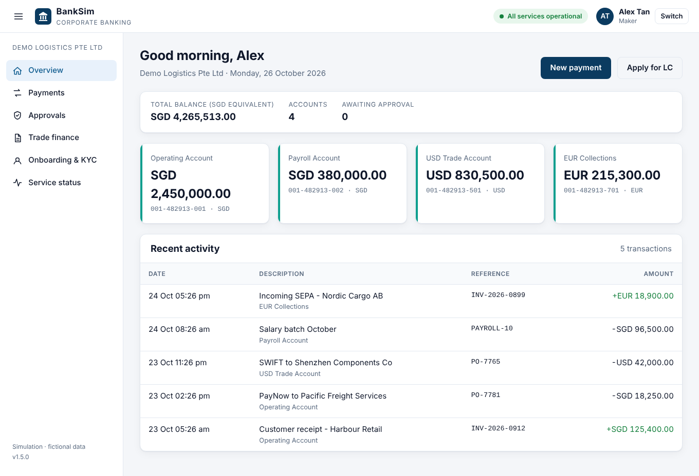

# Bank Platform Simulation: 216 apps on a private-cloud Kubernetes

A hands-on lab that simulates the day-to-day work of a **Cloud / Platform
Engineer at a bank**. The bank runs **200+ banking and transaction
applications** (payments, core banking, trade finance, treasury, risk and
compliance, digital channels, regulatory reporting) on a **private cloud with
Kubernetes**.

You get a running "bank" on your laptop, then work realistic **incident,
change and audit tickets** against it: triage, fix, verify, and write the
incident note, with a timer.

> Built to prepare for a Cloud Engineer role at a bank in Singapore. All
> applications, teams, tickets and data are fictional. Not affiliated with any
> bank.

```
 synthetic customers          edge apps                    what each transaction calls
 (sim-traffic) ──┬──► channels/corporate-portal-api   ──► auth-token-service, account-service ──► core-ledger ──► audit-log-service
                 ├──► payments/payments-gateway        ──► fraud-screening, fx-rates, core-ledger
                 ├──► payments/paynow-fast-adapter     ──► fraud-screening, core-ledger
                 ├──► trade-finance/lc-issuance        ──► sanctions-screening, account-service
                 └──► risk-compliance/kyc-onboarding   ──► sanctions-screening, notification-service

 ...plus ~200 more services across 8 namespaces, each with an owner team, tier, cost centre and upstreams.
```

## Classic Kubernetes debugging cases

Sixteen generic incidents (CrashLoopBackOff, ImagePullBackOff, Pending, OOMKilled, probes,
Services, DNS, RBAC, PVCs, init containers, CoreDNS) that run on any cluster, including the free
Killercoda playground: `./k8s-classics.sh list`. See [`classics/README.md`](classics/README.md).

## Terraform + GitLab CI + Argo CD

The same bank, run the way platform teams do it:
- **Terraform** builds the VPC and EKS (`terraform/`).
- **GitLab CI** tests, builds the image and publishes rendered manifests to a `gitops` branch (`.gitlab-ci.yml`, `ci/`).
- **Argo CD** deploys from that branch (`gitops/argocd/`).

Step-by-step: [`docs/terraform-gitlab-argocd.md`](docs/terraform-gitlab-argocd.md).
Practice drills for incidents, GitOps and AWS failures: [`docs/debugging-practice.md`](docs/debugging-practice.md).
Through a jump host and on Fargate instead of EC2 nodes (`compute = "fargate"`): [`docs/jump-host-fargate.md`](docs/jump-host-fargate.md).

## Corporate banking portal

A customer-facing **corporate e-banking UI**: accounts, PayNow/MEPS+/SWIFT payments with
maker-checker approval, letters of credit and KYC. Every action runs through the bank's real
services, so the incidents you inject show up as customer impact.
Open it with `./sim.sh portal`, or on EKS serve it from **AWS Lambda** with `make portal-lambda IP=<your-ip>`.
See [`docs/bank-portal.md`](docs/bank-portal.md).



## What is inside

| Piece | What it simulates |
|---|---|
| `inventory/applications.yaml` | The CMDB: 216 apps, 8 business domains, owner teams, tiers, cost centres, dependencies |
| `tools/platform.py render` | The **golden path**: one secure, observable, quota-bound deployment pattern generated for every app |
| `platform/` | The "private cloud": a 3-worker kind cluster spread over 2 simulated Singapore data centres (3 zones), plus RBAC |
| `apps/txn-service/portal.go`, `web/` | The corporate banking portal: UI + backend-for-frontend (`txn-service portal`) |
| `lambda/portal-edge` | AWS Lambda front door for the portal on EKS (function URL → internal load balancer) |
| `apps/txn-service` | One small Go service image behind every app. It calls its upstreams per transaction and can be made to crash, leak memory, slow down or fail via env vars |
| Guardrails | Pod Security `restricted`, default-deny NetworkPolicies, ResourceQuota/LimitRange per namespace, PDBs and zone spread for tier-1, team RBAC |
| `tools/platform.py audit` | A technology-risk control audit (7 controls) of manifests or the live cluster |
| `sim.sh` + `scenarios/` | 10 tickets: P1-P4 incidents, changes and an internal-audit finding |

## Quick start

Prerequisites: Docker (give it **6 GB RAM**), [kind](https://kind.sigs.k8s.io) **>= 0.25**,
kubectl, Python 3.9+, make.

```bash
pip install -r requirements.txt
make up                 # cluster + image + 56 apps (lite profile), ~5 minutes
./sim.sh status         # nodes, unhealthy workloads, customer-facing SLOs
./sim.sh dashboard      # live service-health page on http://localhost:8080
```

`make up PROFILE=full` deploys all **216 apps / ~260 pods**. Give Docker 8 GB+ and 4 CPUs.
If your kind version does not enforce NetworkPolicy, use `CNI=calico make up`.

### Or on Amazon EKS (Singapore region)

```bash
aws configure                      # credentials for an account you can create EKS in
make eks-up                        # ~20 min: EKS across 3 AZs + ECR + the bank (~$0.30/hour)
./sim.sh status                    # everything else works the same
make eks-down                      # delete it all when you finish
```

Full guide, costs and troubleshooting: [`docs/eks.md`](docs/eks.md).

## A day in the life

### Morning checks
```bash
./sim.sh status                         # anything red overnight?
make audit                              # platform controls on the live estate
make capacity                           # requests vs quota per namespace
make inventory                          # estate summary + blast radius ranking
kubectl auth can-i create deployments -n payments --as=dev1 --as-group=team-payments   # RBAC model
```

### Tickets

```bash
./sim.sh list           # all tickets + your time-to-resolve
./sim.sh start 01       # inject the fault, print the ticket
./sim.sh hint 01        # stuck? progressive triage hints
./sim.sh check 01       # verify your fix against the acceptance criteria
./sim.sh solution 01    # reference fix, root cause, preventive actions, talking points
./sim.sh reset 01       # back to baseline
./sim.sh page           # on-call mode: a random unsolved incident
```

| ID | Type | Pri | Ticket | Skills |
|----|------|-----|--------|--------|
| 01 | incident | P1 | Outgoing payments failing: payments-gateway down | CrashLoopBackOff, `logs --previous`, ConfigMap drift, GitOps |
| 02 | incident | P2 | Intraday VaR stale: risk-calc-engine restarting | OOMKilled / exit 137, limits vs leaks, `rollout undo` |
| 03 | incident | P1 | Payments time out after a security change | NetworkPolicy selectors, zero-trust without over-permissive fixes |
| 04 | incident | P3 | Release pipeline timed out | ImagePullBackOff, why `maxUnavailable: 0` prevented an outage, private registries |
| 05 | change   | P3 | New app stuck at 0/2 after go-live | ResourceQuota admission, right-sizing, FinOps |
| 06 | incident | P2 | KYC onboarding failing | Readiness vs liveness, empty endpoints, `Recreate` vs `RollingUpdate` |
| 07 | change   | P3 | Monthly OS patching: drain hangs | PodDisruptionBudgets, drain/uncordon, zone-by-zone patching |
| 08 | incident | P1 | Corporate portal "Accounts unavailable" | Service selectors, Running ≠ serving, synthetic monitoring |
| 09 | change   | P4 | Onboard a new application | Golden path: inventory → render → apply, generated NetworkPolicy, config-hash rollouts |
| 10 | audit    | P3 | Internal Audit: privileged container | Pod Security Standards, live audit evidence, `apply` vs `replace`, management response |

Work each one like the real job. Before looking at hints: write down the
customer impact, your hypothesis, and the evidence that confirms it.
After `check` passes, write the incident note: timeline, root cause,
fix, preventive actions.

## How the platform is built

Every app in the inventory gets the same rendered bundle (`rendered/<namespace>/<app>.yaml`):

- **Deployment**: `RollingUpdate` with `maxSurge: 1, maxUnavailable: 0`, readiness and liveness probes,
  non-root / read-only rootfs / drop ALL / seccomp, requests and limits, ownership labels,
  Prometheus annotations, and a `config-hash` annotation so a config change rolls the pods.
- **ConfigMap**: DB URL and `UPSTREAMS`, which the service calls on every transaction.
- **Service**, plus for tier-1 a **PodDisruptionBudget** (`maxUnavailable: 1`), 2 replicas and zone spread.

Every namespace (= business domain) gets:

- Pod Security Admission `restricted`, a ResourceQuota sized from its apps + onboarding headroom, a LimitRange.
- NetworkPolicies: default-deny ingress, allow same namespace, allow edge apps from the traffic tier, and
  `allow-from-consumers` **generated from the dependency graph** in the inventory.
- A RoleBinding giving the owning team deploy rights in its namespace only. No Secrets, no `exec`.

```
make render        # regenerate rendered/ from the inventory
make diff          # what would change in the cluster
make apply
```

## Repository layout

```
inventory/applications.yaml   the 216-app CMDB (source of truth)
tools/platform.py             render | audit | capacity | inventory | status | restore
apps/txn-service/             Go service used by every app (serve | loadgen | portal | probe), portal UI in web/
lambda/portal-edge/           Lambda front door for the portal (EKS)
platform/                     kind and EKS (eksctl) cluster definitions, cluster RBAC
terraform/                    VPC + EKS + node group + add-ons as code
.gitlab-ci.yml, ci/           pipeline: test, build image (no Docker), publish to the gitops branch
gitops/argocd/                Argo CD AppProject + Application
scenarios/NN-*/               ticket.md, hints.md, solution.md, break.sh, check.sh, reset.sh
scripts/                      setup (kind), eks-up / eks-down, deploy, shared shell helpers
docs/                         architecture, triage cheat-sheet, interview notes
sim.sh                        the ticket simulator
```

## Going further

Ideas that map to a real private-cloud platform roadmap:

- **Observability**: kube-prometheus-stack. Scrape the `txn_*` metrics and build SLO alerts per business flow.
- **GitOps**: Argo CD on `rendered/` with self-heal. Replay scenarios 01 and 10 and watch the drift get reverted.
- **Policy as code**: Kyverno/Gatekeeper policies that turn the audit controls into admission rules.
- **DR**: a second kind cluster as "DC2", Velero backups, and a failover runbook for tier-1 flows.
- **Upgrades**: rebuild the cluster on a newer `kindest/node` image node by node (the same skills as scenario 07).
- **Autoscaling**: metrics-server + HPA for month-end batch peaks.

See [`docs/bank-portal.md`](docs/bank-portal.md), [`docs/eks.md`](docs/eks.md), [`docs/architecture.md`](docs/architecture.md), [`docs/triage-cheatsheet.md`](docs/triage-cheatsheet.md)
and [`docs/interview-notes.md`](docs/interview-notes.md).
