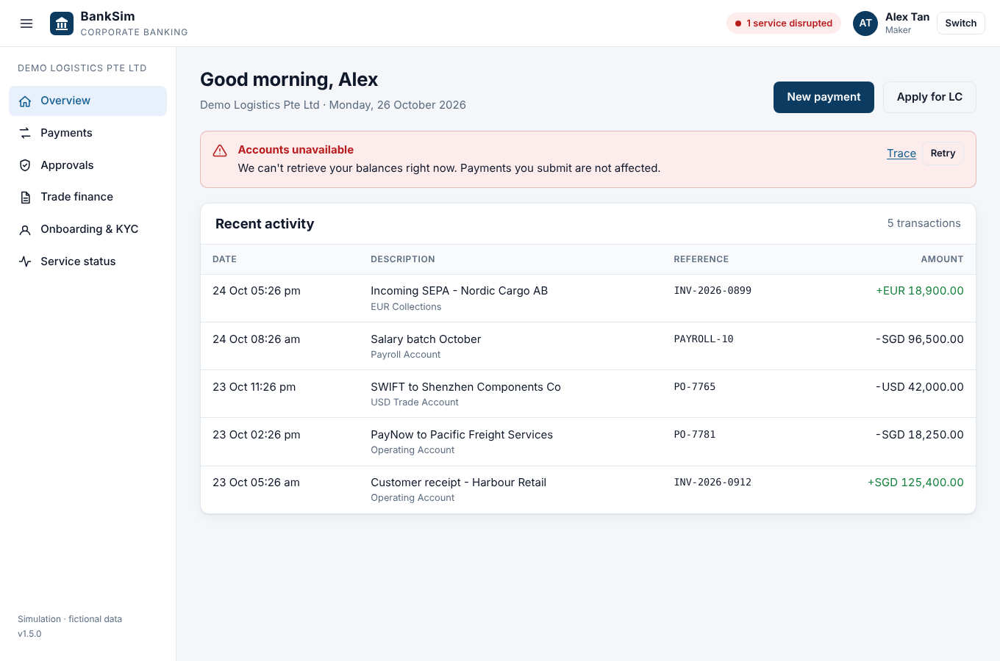
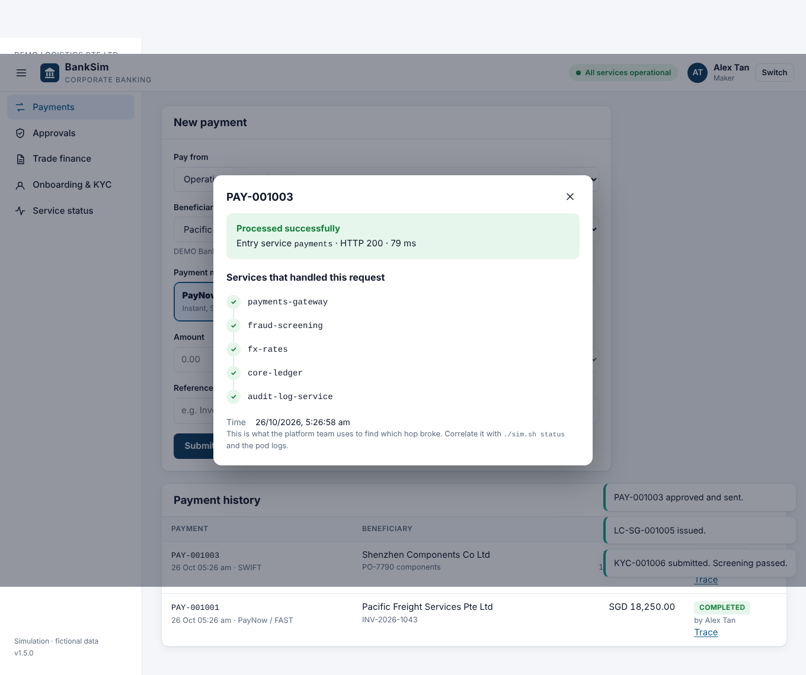

# BankSim corporate banking portal

A corporate e-banking portal for a fictional client, **Demo Logistics Pte Ltd**,
running on top of the simulated bank. Every action is processed by the real
services in the cluster: payments, PayNow, letters of credit, KYC and account
balances. So when you break something with `./sim.sh start <id>`, you see what
customers would see.


| Feature | Backed by (in the cluster) |
|---|---|
| Accounts & balances, recent activity | `channels/corporate-portal-api` → account-service → core-ledger → audit-log |
| PayNow / FAST payments (SGD, up to SGD 200k) | `payments/paynow-fast-adapter` → fraud-screening → core-ledger |
| MEPS+ and SWIFT payments, with FX | `payments/payments-gateway` → fraud-screening → fx-rates → core-ledger |
| Maker-checker approvals above SGD 50,000 | the payment rail above, once a checker approves |
| Letters of credit | `trade-finance/lc-issuance` → sanctions-screening → account-service |
| Onboarding & KYC requests | `risk-compliance/kyc-onboarding` → sanctions-screening → notification-service |
| Service status page | health checks + success rate of the portal's own recent calls |

Demo users: **Alex Tan** (maker: initiates payments and LCs) and **Priya Nair**
(checker: approves payments above SGD 50,000). There's no password; it's a simulation.

## Open it

**kind (laptop)** or any cluster, via port-forward:
```bash
./sim.sh portal                 # http://localhost:8081
```

**EKS, served from AWS Lambda.** Nothing in the cluster is exposed to the internet:
```
browser ──HTTPS──► Lambda function URL ──(inside the VPC)──► internal load balancer ──► bank-portal (EKS)
                   serves the UI, IP allow-list             VPC-only, no public IP
```
```bash
make eks-deploy                 # build + push v1.5.0 and roll it out (keeps your cluster as it is)
make portal-lambda IP=<your-ip> # open https://checkip.amazonaws.com in your browser to find <your-ip>
./scripts/portal-lambda.sh status
make portal-lambda-down         # also done automatically by make eks-down
```
`portal-lambda` creates:
- an internal load balancer `bank-portal-internal`, restricted to the VPC CIDR
- a security group
- an IAM role with only `AWSLambdaVPCAccessExecutionRole`
- the function `bank-sim-portal` (Python, arm64) in the cluster's private subnets
- a function URL

It finishes with a smoke test that calls the portal in EKS through the function. If your IP
changes (mobile hotspot, office network), run it again with the new IP.

Teardown note: Lambda releases its network interfaces in the VPC asynchronously, so deleting its
security group can take up to ~20 minutes. `portal-lambda-down` waits for that; without it,
deleting the VPC would fail.

## What each ticket looks like to a customer

Start a ticket, then use the portal as Alex or Priya:

| Ticket | Customer-visible impact |
|---|---|
| 01 payments-gateway down | MEPS+ and SWIFT payments fail; **PayNow still works** (different path) |
| 02 risk engine OOMKilled | none: internal risk system. Not every incident is customer-facing |
| 03 network policy change | every payment and LC fails after a ~2 s timeout; KYC still works (kyc-onboarding sits *inside* the restricted namespace) |
| 04 release stuck | none: `maxUnavailable: 0` kept the old version serving |
| 06 notification-service | KYC requests fail |
| 07 node patching | none, if you drain safely; watch the portal while you drain |
| 08 Service selector | **"Accounts unavailable"** on the dashboard, and LC applications fail |



The **Trace** button on each payment, LC or KYC case shows the services the request
went through, and where it broke. Customers only ever see a safe message such as
"No money has been debited"; the internal details stay in the trace.



## Banking controls built in (talking points)

- **Money as integer minor units** (cents), never floating point. FX conversion rounds
  half-up, once.
- **Idempotency keys:** a retried or double-clicked payment is recognised and never sent twice.
- **Maker-checker with segregation of duties:** checkers can't initiate, makers can't
  approve, and nobody approves their own payment. The balance is re-checked at execution.
- **Atomic posting:** the account is debited only after every service in the chain accepted
  the payment. A failed payment moves no money.
- **Rail rules:** PayNow/FAST and MEPS+ are SGD-only, and FAST is capped at SGD 200,000 per payment.
- **Input validation** on the server (amount format, references, dates, ISO country codes),
  plus strict JSON decoding with size limits.
- **Web security headers:** a strict Content-Security-Policy (no inline scripts or styles),
  `frame-ancestors 'none'`, `nosniff`, `no-referrer`, `no-store` on API responses, and HSTS on Lambda.
- **No external dependencies:** no CDNs or web fonts, so it works in an air-gapped bank network.
- **No internal details leak to customers:** service names and addresses appear only in the
  operations trace.

## What a production portal would add

This is a training simulation. In an interview, be ready to explain the gaps:

| Here | In production |
|---|---|
| Demo persona picker | SSO with the bank's identity provider (OIDC/SAML), MFA and hardware tokens, session timeouts |
| State in memory, 1 replica | Database or ledger service, stateless replicas behind a load balancer |
| Trace shown in the customer UI | Traces (OpenTelemetry) go to operations tooling only |
| Function URL + IP allow-list | CloudFront + AWS WAF + TLS on the bank's domain, or a private API Gateway |
| Plain HTTP inside the VPC | mTLS between services (service mesh), encryption everywhere |
| Fixed FX rates | Live rates with a quote ID and expiry, held during approval |

## Code

- `apps/txn-service/portal.go`: backend-for-frontend (`txn-service portal`), with tests in `portal_test.go`
- `apps/txn-service/web/`: the UI (HTML, CSS, JS; no build step)
- `lambda/portal-edge/handler.py`: the Lambda front door, with tests in `test_handler.py`
- `scripts/portal-lambda.sh`: deploy and remove the Lambda path
